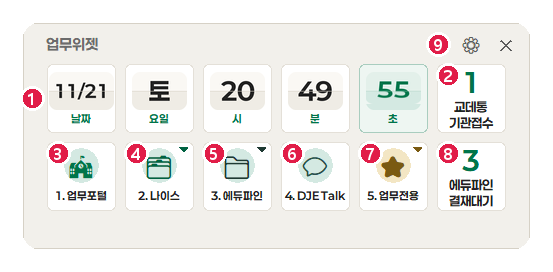
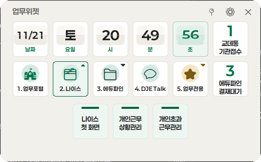
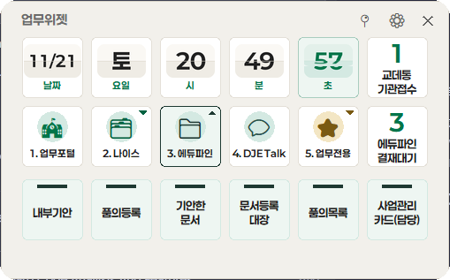
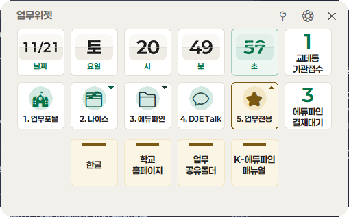
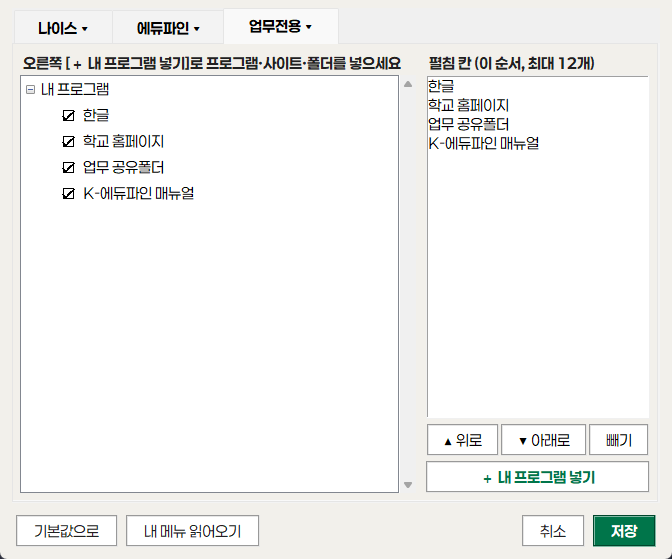

# 🧩 업무위젯 사용설명서 만든 사람 · 대전동산고 J.S.

단추 한 번이면 **인증서 로그인부터 업무 화면까지** 알아서 열어 줍니다.
화면을 열고 복무·출장·초과근무 신청 칸을 채워 주기만 하고, 결재·저장·상신(승인요청)은 선생님이 직접 합니다.

> 🔒 **개인정보 걱정 없이 쓰세요** — 이 프로그램은 **선생님 PC에만 저장되고, 선생님 PC에서만 실행**됩니다.
> 인증서 암호·설정·화면 내용을 **서버를 통해 외부로 보내지 않으며**, 만든 사람에게도 전달되지 않습니다.
> - 인증서 암호는 이 PC의 «Windows 자격 증명 관리자»에만 있고, 업무포털·나이스 로그인할 때만 꺼내 씁니다.
> - 위젯이 접속하는 곳은 선생님이 누른 업무포털·나이스·에듀파인·DJE 메신저뿐입니다.
> - 업데이트는 GitHub에서 새 버전을 **받아 오기만** 하고, 이 PC의 정보는 올려 보내지 않습니다.

> 그림이 든 사용설명서는 위젯 **⚙ → 도움말 → 사용설명서**, 또는 설치 묶음의 `사용설명서.html` 에서 볼 수 있습니다.

| | 칸 | 하는 일 |
|---|---|---|
| 1 | 날짜·시계 | 오늘 날짜와 지금 시각 |
| 2 | 기관접수 | 교데통 기관접수대기 건수 · 누르면 그 화면 |
| 3 | 업무포털 | 로그인해서 메인 화면까지 |
| 4 | 나이스 ▾ | 펼쳐서 복무·출장·초과근무 신청, 복무 화면으로 바로 |
| 5 | 에듀파인 ▾ | 펼쳐서 내부기안·품의로 바로 |
| 6 | DJE Talk | 메신저 자동 로그인 (대전 밖은 «내부기안») |
| 7 | 업무전용 ▾ | 내가 넣은 프로그램·사이트·폴더 |
| 8 | 결재대기 | 결재할 문서 수 · 누르면 결재대기함 |
| 9 | ⚙ | 설정·도움말·사용설명서 |

## ▾ 칸은 누르면 펼쳐져요

| 나이스 ▾ | 에듀파인 ▾ | 업무전용 ▾ |
|---|---|---|
|  |  |  |

## 복무·출장·초과근무 신청

나이스 ▾ 를 펼치면 **주황색 ✎ 칸은 «신청»**(나이스 칸을 채워 줌), **초록 칸은 «화면 열기»**예요. 채우기가 끝나면 **알림 창**이 떠요.

1. **«2. 나이스 ▾» → «복무 신청» / «출장 신청» / «초과근무 신청»** 을 누릅니다.
2. 종류·날짜·시각과 사유(출장지·목적, 할 일)를 적고 **[나이스에 채우기]** 를 누릅니다. 시각은 `1300` 처럼 적어도 돼요.
3. 나이스 신청 창에 칸이 채워져 있어요. **일수·시간 합이 맞는지 보고, 결재선을 고른 뒤 [승인요청]은 직접** 누르세요.

> 위젯은 칸만 채우고 승인요청(상신)은 누르지 않아요.
> - 복무: 조퇴·외출·지각·병가(병원 진료면 «병조퇴·병외출·병지각»)·육아시간. **끝 날짜를 다른 날로 고르면 매일 같은 시각**(나이스 «일반복», 주말은 나이스가 뺌)
> - 출장: 같은 시도교육청 안이면 관내, 밖이면 관외. 하루 안의 몇 시간짜리는 «0일 ○시간»으로 맞춰 넣어요
> - 초과근무: **달력에서 여러 날을 고르면 한 번에** 올려요 (나이스 [행추가]로 날마다 한 줄). 토·일은 «휴일»에 저절로 체크돼요 (공휴일은 «고른 날 모두 휴일»). 휴일 초과근무는 **전날 18시 전**에 올려야 사전신청으로 인정돼요

## 업무전용 칸 채우기 (1분)

1. **«5. 업무전용»** 을 누릅니다 (처음엔 비어 있어서 넣는 창이 바로 열려요).
2. **[＋ 내 프로그램 넣기]** → 프로그램을 고르거나, 웹 주소를 붙여 넣거나, [파일…]·[폴더…]로 고릅니다.
3. **칸 이름**을 적고 **[넣기]** → **[저장]**.

## 처음 설치 (한 번만)

1. 받은 압축 파일을 **오른쪽 클릭 → 모두 풀기**
2. `install_widget.cmd` **더블클릭** 후 기다리기
3. 설정 창에서 지역 고르고 **인증서 암호** 입력 → 저장

위젯이 뜨면 **«1. 업무포털»** 을 눌러 보세요. 15~35초 뒤 업무포털 메인이 보이면 성공!
새로 설치할 분께는 최신판 주소를 알려 주세요: https://github.com/husky7025/work-widget/releases/latest/download/work-widget-setup.zip

## 꼭 기억할 세 가지

- 🟢 **초록 크롬 = 업무용** — 위젯은 창 위쪽이 초록색인 업무용 크롬을 따로 띄워요.
- ✋ **로그인 중엔 손 떼기** — 크롬이 로그인하는 동안 창을 만지면 멈춰요.
- 🔒 **화면을 열고 칸만 채워 줘요** — 승인요청·결재·저장은 하지 않고, 인증서 암호는 이 PC에만 저장돼요.

## 막히면

PC가 느려서 위젯이 버벅이면 **⚙ → 화면 → 가벼운 모드**를 켜 보세요.

위젯 아래쪽 문구를 보고, 그래도 모르겠으면 **⚙ → 도움말 → 문제 해결용 기록 복사** → 메신저에 붙여넣기(Ctrl+V)해서 보내 주세요.

---

## 📖 자세한 설명서

<b>준비물</b>

- 구글 크롬 또는 마이크로소프트 엣지 (웨일은 안 됩니다). 위젯 오른쪽 클릭 → «브라우저 (크롬·엣지)»에서 고릅니다.
- 이 컴퓨터에 내 교육행정 인증서 (보통 `C:\GPKI\Certificate\class2`). USB 인증서는 자동 선택이 안 됩니다.
- 나이스 인증서 프로그램이 실행 중이어야 합니다.
- 학교 업무망(랜선). 설치할 때 인터넷이 필요합니다 (막히면 휴대폰 테더링으로 한 번만).

<b>설치 자세히</b>

1. 압축 파일을 **오른쪽 클릭 → 모두 풀기** (풀지 않고 열면 안 돼요).
2. `install_widget.cmd` 더블클릭. «게시자를 확인하지 못했습니다» → [실행], 파란 «Windows의 PC 보호» → 추가 정보 → [실행].
3. «업무 위젯을 설치하고 있어요» 창은 닫지 말고 기다립니다.
4. 설정 창: 지역 → 인증서 이름 확인 → 인증서 암호(글자가 안 보이는 게 정상) → 연락처(선택) → [저장하고 위젯 켜기].

클로드 앱 안에서 설치하지 마세요. 탐색기에서 더블클릭해야 설정이 제대로 저장됩니다.

<b>안심하고 쓰세요 (암호·보안)</b>

- 인증서 암호는 이 PC의 «Windows 자격 증명 관리자»에만 저장되고, 밖으로 보내지 않습니다.
- 위젯은 화면을 «열기만» 합니다. 결재·상신·저장 버튼은 누르지 않습니다.
- 업데이트는 전자서명을 확인한 뒤에만 설치됩니다.
- 인증서 이름·암호를 메신저로 주고받지 마세요. 자리 비울 땐 ⊞+L.

<b>펼침 칸 메뉴 바꾸기</b>

**⚙ → 펼침 메뉴 고르기** → 처음 한 번 [내 메뉴 읽어오기](1분쯤) → 탭(나이스/에듀파인/업무전용)에서 넣기·빼기·순서 바꾸기 → [저장]. 칸마다 12개까지. [＋ 내 프로그램 넣기]로 프로그램·파일·폴더·웹 주소도 넣을 수 있습니다. 입력 창이나 팝업을 쓰는 중이면 화면을 옮기지 않고 알려만 줍니다.

<b>결재대기·기관접수 숫자 칸</b>

- **결재대기**: 30분마다 읽음, 누르면 결재대기함, 오른쪽 클릭은 숫자만 새로고침. 있으면 노란 음영, 긴급이면 붉은 음영, 새로 오면 윈도우 알림(⚙ → 자동 실행·알림에서 끄기).
- **기관접수**: 교데통 «데이터취합 › 제출자료 › 기관접수대기» 건수, 누르면 그 화면.
- 숫자는 업무포털에 로그인돼 있어야 읽힙니다. 안 되면 `--`.

<b>화면 바꾸기 (시계·투명도·크기·자동 접기·업무전용 칸·가벼운 모드)</b>

- **⚙ → 화면 → 시계 카드 보이기**: 날짜·요일·시·분·초 카드를 하나씩 켜고 끄기.
- **⚙ → 화면 → 투명도 / 위젯 크기** (크기를 바꾸면 위젯이 다시 켜져요).
- **⚙ → 화면 → 자동 접기**: 정한 시간(1·3·5·10·30분, 또는 «직접 정하기…»로 1~600분) 동안 안 쓰면 작은 둥근 단추로 접힘. 단추를 누르면 펼쳐지고, 끌면 옮겨짐. 결재대기 건수가 단추에 보임. 처음엔 꺼져 있음.
- **⚙ → 화면 → 업무전용 칸 쓰기**: 끄면 예전 배치(월·일 따로, 아랫줄 끝에 결재대기·기관접수). 넣어 둔 목록은 그대로 남습니다.
- **⚙ → 화면 → 가벼운 모드** (느린 PC용): 시계는 넘김 그림 없이 숫자로, 결재대기 반짝임·서서히 사라지기 끔, 결재대기·기관접수 숫자는 자동으로 읽지 않고 **칸을 오른쪽 클릭할 때만** 읽음. 바꾸면 위젯이 다시 켜져요. 메모리 6GB 미만·코어 2개 이하 PC에서는 처음 켤 때 한 번 물어봐요.

<b>닫기·다시 열기·자동 업데이트</b>

- ✕ 는 작은 둥근 단추로 접기(누르면 다시 펼쳐짐, 오른쪽 클릭하면 펼치기·닫기·종료). – 는 시스템 트레이로 내려 보내기. 트레이 아이콘을 누르면 다시 나오고, 오른쪽 클릭으로 자동 실행·완전 종료.
- 위젯을 켤 때와 매일 정오에 새 버전을 확인해 알아서 바꿉니다. 지금 확인: ⚙ → 도움말 → 업데이트 확인. 설정·암호·펼침 칸은 그대로입니다.

<b>안 될 때</b>

| 이럴 때 | 이렇게 하세요 |
|---|---|
| «암호를 넣었지만 로그인이 안 됐습니다» | ⚙ → 환경설정에서 암호를 다시 저장. 틀린 채로 여러 번 누르면 인증서가 잠길 수 있어요 |
| 로그인·인증서 창이 안 뜸 | 나이스 인증서 프로그램 확인, 컴퓨터 다시 켜기 |
| «중복로그인…» | 평소 크롬에서 같은 계정 로그아웃 |
| 결재대기·기관접수 칸이 `--` | «1. 업무포털» 로그인 후 칸을 오른쪽 클릭(결재대기) / 한 번 누르기(기관접수) |
| 업무전용 칸이 «파일이 없어요» | ⚙ → 펼침 메뉴 고르기에서 빼고 다시 넣기 |
| 설치 창에 «설치가 끝나지 않았어요» | `업무위젯_설치기록.txt` 를 알려 주신 분께 보내기 |

<b>지우기 · 알아 두세요</b>

- 설치 묶음 폴더의 `uninstall_widget.cmd` → «예». 위젯·바로가기·저장된 설정과 암호가 지워지고, 크롬과 인증서 파일은 남습니다.
- 공개된 «나이스 자동화 키트»(MIT) 위에서 돌아갑니다. 학교·교육청 지침에 어긋날 수 있으니 본인 계정·인증서로 본인 업무에만 쓰세요.
- 품의등록·결재대기는 한 학교(대전동산고) 화면에서만 시험했습니다.

